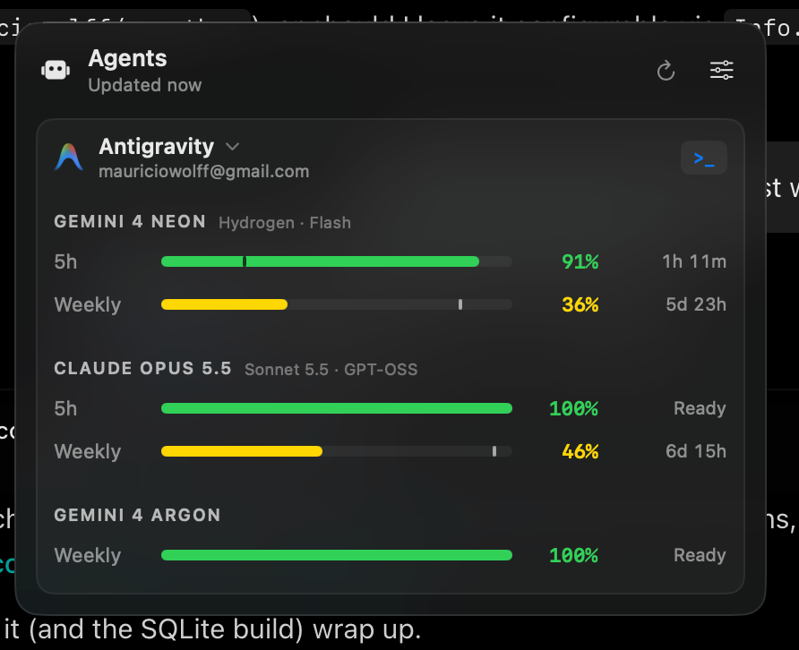

# AgentBar

A Raycast-style floating HUD for macOS that shows how much AI coding quota you
have left. One card per provider: **Antigravity**, **OpenCode Go**, **Codex**,
and **Claude Code**.

<p align="center">
  
</p>

Press `⌥⇧A` anywhere and the panel fades in at the top of the screen with the
remaining percentages, reset countdowns, and a pace marker on every bar. Press
`Esc` to dismiss.

```
collector/   Go CLI: one collector per provider, normalized JSON, SQLite history
macos/       SwiftUI app (bundles the collector at Contents/Helpers)
scripts/     release.sh: build, Developer ID sign, notarize, publish
```

## Why

Every provider invents its own quota screen, and most of them only show it
after you burn a request. AgentBar reads each one non-destructively, normalizes
the result, and puts all of them in one panel:

| Provider | Source |
| --- | --- |
| Antigravity | `agy /usage` driven in a PTY |
| OpenCode Go | `opencode api GET /api/experimental/usage/limits`, or `OPENCODE_GO_API_KEY` against `opencode.ai` |
| Claude Code | `claude` in a PTY, `/usage` panel |
| Codex | newest `~/.codex/sessions/**/*.jsonl` `token_count` event (read-only) |

Missing CLIs are skipped, so the HUD only shows what you actually use.

## Requirements

- macOS 13+ and Xcode Command Line Tools for the app
- Go 1.21+ to build the collector
- Any subset of the CLIs above, signed in on the same machine

## Install

```bash
git clone https://github.com/bitbonsai/agentbar.git
cd agentbar
./macos/build-app.sh
cp -R dist/AgentBar.app /Applications/
open /Applications/AgentBar.app
```

The bundle carries `Contents/Helpers/agentbar-collector`; the app also falls
back to `~/.local/bin`, `/opt/homebrew/bin`, and `/usr/local/bin`.

Releases are built by `scripts/release.sh` and published as a notarized
`AgentBar-<version>-macOS.zip` on the [releases page][releases].

[releases]: https://github.com/bitbonsai/agentbar/releases

## The HUD

The panel is 420pt wide, upper-center of the screen holding the pointer, with a
glass background (`NSVisualEffectView`, `.hudWindow`) and a 140ms fade + scale.

- **`⌥⇧A`** toggles the HUD from anywhere, including fullscreen spaces
  (Carbon hotkey, no Accessibility permission). It also opens on launch and
  whenever the app is re-opened (`open -a AgentBar`, Spotlight, Raycast).
- **`Esc`** closes, **`⌘R`** force-refreshes, **`⌘O`** opens `agy` in the
  terminal, **`⌘Q`** quits.
- Menubar icon: left click toggles the HUD, right click opens a native menu
  (Show HUD, Refresh, Theme, Menubar style, Quit).

Every provider gets a card with icon, name, account or workspace subtitle, a
collapse toggle, and a `>_` button that opens that provider's CLI (`agy`,
`opencode`, `claude`, `codex`) in Ghostty, iTerm, or Terminal. Cards with a
single group hide the group header; Antigravity keeps its `GEMINI 4 NEON` /
`CLAUDE OPUS 5.5` / `GEMINI 4 ARGON` headers.

Rows show `5h`, `Weekly`, and `Monthly` in that order, a pace tick on each bar
(where a linear burn would leave you right now), colour coding (<50% warn,
<20% critical), monospaced percentages, and reset countdowns (`6d 0h`,
`2h 34m`, `Ready`). The collector runs every 5 minutes; the header shows the
data age. The menubar percentage is the lowest remaining quota across every
healthy provider.

### Themes

Settings (the slider icon in the header, or the status menu):

- **System** (default): real macOS vibrancy, follows Dark/Light automatically.
  Bars stay neutral (`.labelColor` at 80%) and only turn amber (<50%) or coral
  (<20%) when quota runs low.
- **Catppuccin (Auto)**: Mocha in Dark, Latte in Light, translucent.
- **Catppuccin Mocha** / **Catppuccin Latte**: forced dark or light.

Menubar style lives in the same menu: `Icon only` (default), `Icon + %`, or
`Hidden` (HUD only). Both settings persist in `@AppStorage` / `UserDefaults`.

### Custom icon

Drop `MenuBarIcon.png` (or `.svg`) into `macos/Resources/` and rebuild. The
build script copies `macos/Resources/*` into `Contents/Resources/`, and the app
uses it as a template image for the menubar and the HUD header. Without it the
app falls back to the `sparkles` SF Symbol.

## Collector

```bash
cd collector
go test ./...
go build -o agentbar-collector .

./agentbar-collector --json              # cached snapshot, refreshes after 5m
./agentbar-collector --json --refresh    # fresh query of every provider
./agentbar-collector --waybar            # Waybar module JSON
./agentbar-collector --parse-file /tmp/agy-usage.txt --json
```

Flags: `--json` (default `true`), `--waybar`, `--refresh`, `--cache-ttl`
(default `5m`), `--timeout` (per provider; `0` = provider default: agy 15s,
OpenCode 6s, Claude 25s, Codex 6s), `--parse-file`, `--db`, `--no-history`,
`--history`.

Collectors run concurrently and appear in a stable order: `antigravity`,
`opencode`, `claude`, `codex`. A provider whose CLI or data directory is
missing is dropped from the snapshot entirely.

### Provider notes

- **Antigravity** runs `agy` in a 60x140 PTY (the whole `/usage` page fits)
  inside `~/Library/Caches/agentbar/workspace` (`$XDG_CACHE_HOME/agentbar/`
  `workspace` on Linux) so the folder-trust prompt covers an empty scratch dir.
  `GEMINI_*`, `AGY_*`, and `ANTIGRAVITY_*` are stripped from the child env.
- **OpenCode Go** shells out to `opencode api GET
  /api/experimental/usage/limits` (`$PATH` or `~/.bun/bin`, 6s). Without the
  CLI it falls back to `https://opencode.ai/inference/go/v1/usage` with
  `OPENCODE_GO_API_KEY`. Windows: `5h` (rolling), `Weekly`, `Monthly`.
- **Claude Code** drives `claude --ax-screen-reader` in a 50x120 PTY inside
  `~/Library/Caches/agentbar/claude-workspace`, accepts the folder-trust
  prompt, opens `/usage`, and reads the plan percentages. API-billing accounts
  report no plan limits, so the card reads "No quota limits reported"; a
  signed-out CLI yields `status: not_signed_in`.
- **Codex** scans `~/.codex/sessions/` newest-first and reads the last
  `event_msg` / `token_count` entry with `rate_limits` (no prompts, no
  network). The window label follows the reported `window_minutes`, so a
  weekly-primary plan still renders as `Weekly`.

Both PTY collectors set `TERM=xterm-256color` and drop nested-session env vars.

### JSON shape

```json
{
  "updatedAt": "2026-11-22T15:54:10Z",
  "providers": [
    {
      "id": "antigravity",
      "name": "Antigravity",
      "account": "you@example.com",
      "status": "ok",
      "groups": [
        {
          "id": "gemini-models",
          "name": "Gemini Models",
          "description": "Gemini 4 Neon, Gemini 4 Hydrogen, ...",
          "windows": [
            {
              "id": "weekly",
              "label": "Weekly",
              "rawLabel": "Weekly Limit Remaining",
              "remainingPct": 39.05,
              "usedPct": 60.95,
              "statusText": "Resets in 144h 16m",
              "resetsInMinutes": 8656,
              "windowMinutes": 10080,
              "paceRemainingPct": 85.87
            }
          ]
        }
      ]
    }
  ]
}
```

`status` is `ok`, `not_signed_in`, or `error`. `paceRemainingPct` is the
remaining % a linear burn would leave right now
(`resetsInMinutes / windowMinutes * 100`), used for the tick on each bar.

### Usage history (SQLite)

Every fresh collection appends the snapshot to a local SQLite database
(`modernc.org/sqlite`, pure Go, so `GOOS=linux GOARCH=amd64 go build` needs no
CGO).

- macOS: `~/Library/Application Support/agentbar/history.db`
- Linux: `$XDG_DATA_HOME/agentbar/history.db`, falling back to
  `~/.local/share/agentbar/history.db`

Failures only warn on stderr; `--json` / `--waybar` stdout is never polluted.

```bash
./agentbar-collector --history 24h          # recent samples as JSON
./agentbar-collector --history 7d --db /tmp/history.db
./agentbar-collector --refresh --no-history # skip recording once
```

One row per provider / model group / window, written only for providers with
`status: ok`. A reading is skipped when it matches the last stored row for the
same `(provider_id, group_id, window_id)` within 0.01% and less than 30 minutes
have passed, so idle quota keeps one row every half hour instead of one per
poll.

```sql
CREATE TABLE IF NOT EXISTS quota_samples (
  id INTEGER PRIMARY KEY AUTOINCREMENT,
  recorded_at TEXT NOT NULL,
  provider_id TEXT NOT NULL,
  account TEXT NOT NULL DEFAULT '',
  group_id TEXT NOT NULL,
  group_name TEXT NOT NULL,
  window_id TEXT NOT NULL,
  remaining_pct REAL NOT NULL,
  used_pct REAL NOT NULL,
  resets_in_minutes INTEGER,
  pace_remaining_pct REAL
);
CREATE INDEX IF NOT EXISTS idx_quota_samples_lookup
  ON quota_samples (provider_id, group_id, window_id, recorded_at);
```

```bash
sqlite3 "$HOME/Library/Application Support/agentbar/history.db" \
  "SELECT recorded_at, group_id, window_id, remaining_pct
     FROM quota_samples
    WHERE provider_id = 'antigravity'
    ORDER BY recorded_at DESC LIMIT 10;"

# burn per day for one group / window
sqlite3 "$HOME/Library/Application Support/agentbar/history.db" \
  "SELECT substr(recorded_at, 1, 10) AS day,
          round(max(used_pct) - min(used_pct), 2) AS used_delta_pct
     FROM quota_samples
    WHERE group_id = 'gemini-models' AND window_id = 'weekly'
    GROUP BY day ORDER BY day DESC LIMIT 14;"
```

## Releasing

`scripts/release.sh` builds, signs with a Developer ID, optionally notarizes,
and optionally publishes.

```bash
# one-time: store notarization credentials in the keychain
xcrun notarytool store-credentials "agentbar-notary" \
  --apple-id you@example.com --team-id HX4V85BM62 --password <app-specific-password>

# build + Developer ID sign + verify (no notarization)
./scripts/release.sh

# notarize, staple, re-zip, and verify Gatekeeper acceptance
./scripts/release.sh --notarize --profile agentbar-notary

# ...and create the GitHub release v<version> with the zip attached
./scripts/release.sh --notarize --profile agentbar-notary --publish
```

Version comes from `macos/Info.plist` (`CFBundleShortVersionString`); override
with `--version 1.2.3`. Output lands in `dist/AgentBar-<version>-macOS.zip`.
The signing identity comes from
`CODESIGN_IDENTITY` (default: `Developer ID Application: Mauricio Da Cunha
Wolff (HX4V85BM62)`). `--notarize` needs `NOTARY_PROFILE` or `--profile`.
`--publish` needs an authenticated `gh` CLI.

## Troubleshooting

- `not signed in`: run `agy` once and finish the browser sign-in.
- Collector hangs or returns garbage after an agy update: capture the screen
  with `AGENTBAR_RAW_DUMP=/tmp/agy.txt agentbar-collector --refresh`, then
  iterate on `collector/internal/agy/parser.go` with `--parse-file /tmp/agy.txt`.
  Parser tests use a checked-in fixture of the `/usage` screen.
- HUD shows nothing: run `agentbar-collector --refresh` once and check stderr.

## License

MIT. See [LICENSE](LICENSE).
